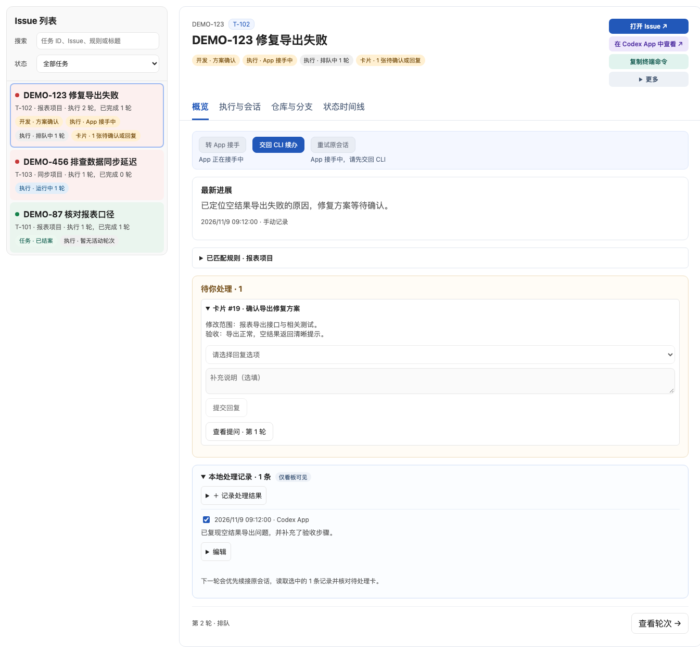
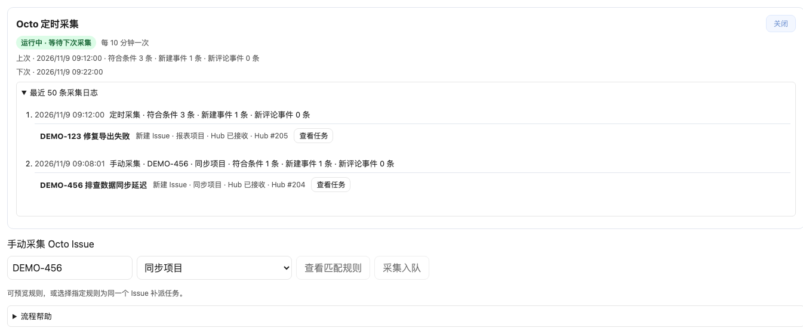
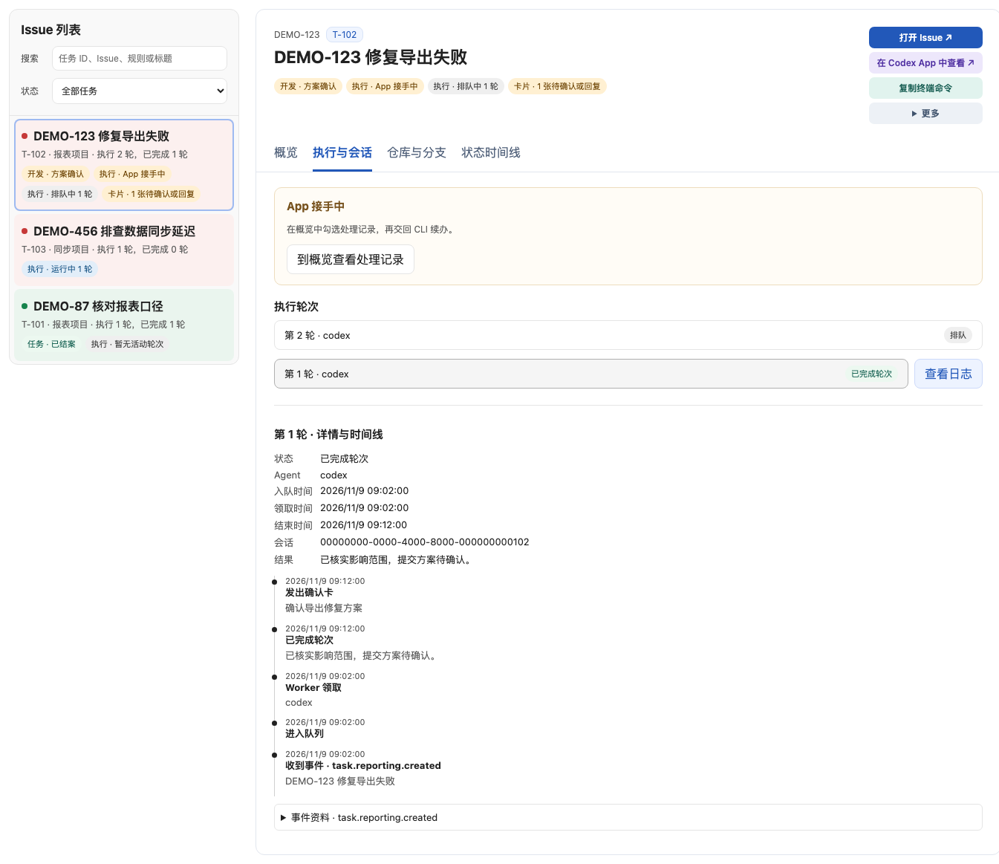
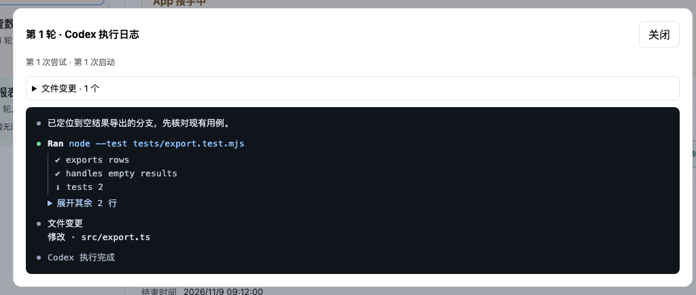
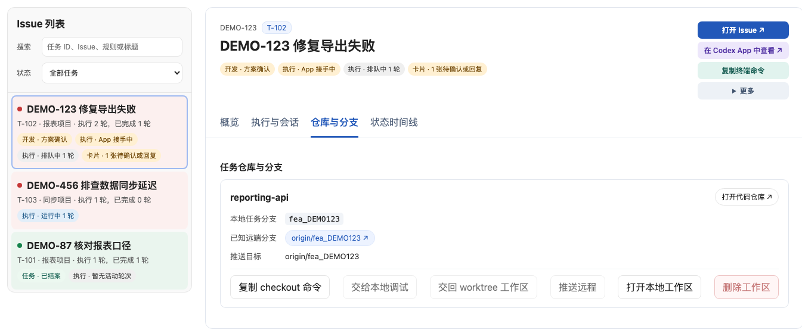
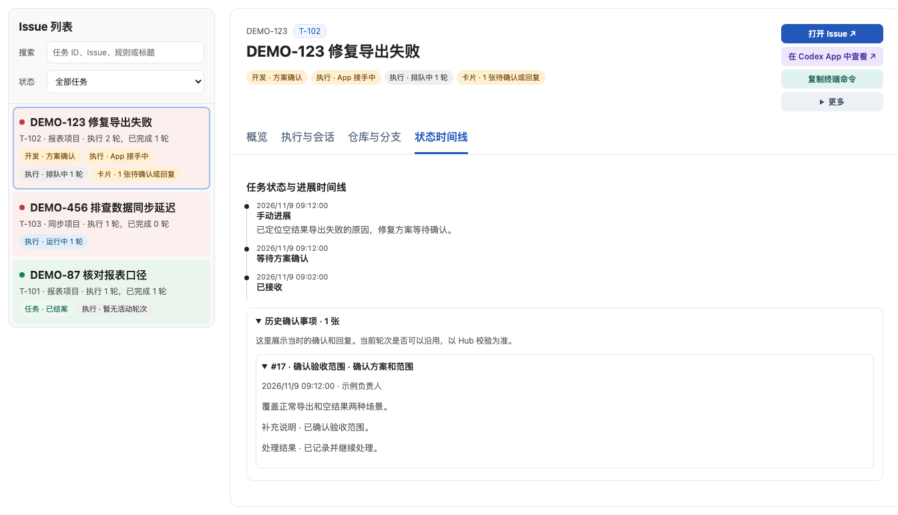
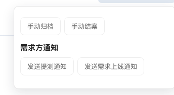

# loopj · Agent Autoloop 看板

loopj 是 Agent Autoloop 的本机 Web 看板。它把 Issue、匹配规则、执行轮次、确认卡和 Git 工作区放在同一页，方便跟进后台 Agent 的任务。



截图来自内置演示模式，所有 Issue 和执行记录均为虚构数据。

## 体验和启动

需要 Node.js 24 或更新版本。从本仓库运行：

```bash
node server.mjs --demo
```

打开 [本机看板](http://127.0.0.1:3351)。演示模式可以浏览示例任务、确认卡和轮次时间线。

连接真实 Hub 时，请把 Hub 源码放在同一父目录的 `agent-autoloop` 下，先按 Hub README 初始化并启动，再在本仓库运行：

```bash
node server.mjs
```

看板默认读取 `~/.agent-autoloop/config.json`。也可以使用 `--config <配置文件>` 或 `--port <端口>`。看板只监听本机回环地址，Hub 的所有者密钥由服务端读取。

## 页面功能

| 页面 | 可以做什么 |
| --- | --- |
| Issue 列表与概览 | 按任务 ID、Issue、规则或标题搜索。查看进展、结案状态和确认卡，提交回复或手动结案 |
| 执行与会话 | 查看执行轮次、事件时间线和实时 Codex 日志。展开命令输出或打开原始 stdout，接手 App 会话或交回 CLI |
| 仓库与分支 | 查看需求分支和远端目标，接管已有工作区，复制 checkout 命令，把分支交给原项目目录调试或交回 worktree，确认后推送 |
| 状态时间线 | 查看阶段变更、人工进展和结案记录 |
| Octo 采集 | 启用定时采集、查看最近采集明细、预览规则匹配或指定规则入队。启用前按 Hub 的 Octo 文档配置 |

## 看板截图

### 采集与规则匹配

定时与手动采集记录、事件明细，以及指定规则补派任务。



### 执行与会话

轮次状态、App 接手提示、会话标识和执行时间线。



### Codex 执行日志

命令状态、折叠的长输出和文件变更摘要。



### 仓库与分支

需求分支、远端目标、复制 checkout 命令，以及本地调试和 worktree 交接。



### 状态与确认历史

任务进展、开发阶段和以往确认卡的答复。



### 任务管理与交付通知

手动归档、结案，以及配置 Octo 后的提测与上线通知。



## 规则如何影响看板

规则由 Hub 的 `rules.json` 管理，定义事件来源、匹配条件、Agent、工作目录和可选仓库配置。Hub 按规则与事项派发任务。一个 Issue 命中多条规则时，看板会显示多条可独立搜索的任务。

代码任务可以先发方案确认卡。获批后，Worker 在对应 worktree 里继续执行。任务接手、交回、提测、上线和结案都有各自的状态，执行完一轮后仍可按任务继续跟进。

发布时保留本仓库的源码与虚构演示数据。真实运行数据、日志、配置和凭据由本机 Hub 保存。
